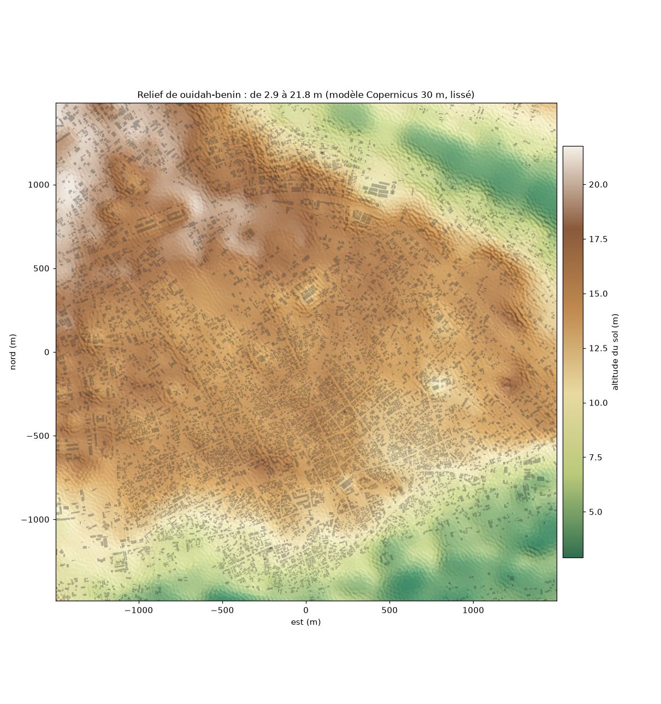
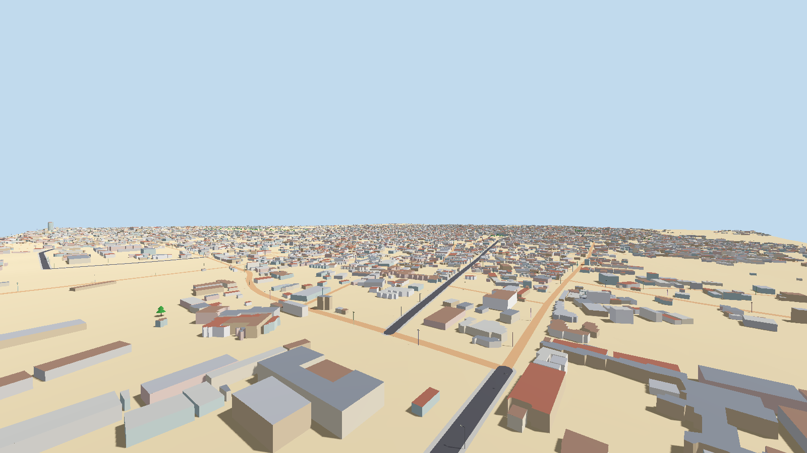

# ayigba

Générateur automatique de cartes 3D fidèles à de vrais lieux, pour les moteurs de jeu.
Priorité au Bénin : Cotonou d'abord, puis Ouidah, Porto-Novo et Parakou.

> « Ayigba » : la terre, le sol.


*Cadjèhoun et l'aéroport de Cotonou, générés en une commande et ouverts dans Godot 4.7.*



*Ouidah : altitude du sol telle qu'un moteur l'affichera (modèle Copernicus 30 m, lissé), avec les bâtiments en gris.*



*Ouidah dans Godot, à l'échelle réelle. Données : © les contributeurs d'OpenStreetMap (ODbL) ; contient des données Copernicus ; Google Open Buildings 2.5D (CC BY 4.0).*

## Principe

La cohérence passe avant la fidélité à 100 %. Une carte sans trou, sans mur invisible et sans zone mal formée vaut mieux qu'une copie exacte mais cassée. Là où les données manquent, l'outil génère lui-même et marque ce qui est généré.

L'outil est indépendant de tout jeu : il ne contient ni missions, ni météo, ni scénario. Il produit une carte et ses données, c'est tout.

## État actuel (22/11/2026)

Nouveautés du 22/11/2026 (toutes facultatives et désactivées par défaut, les cartes existantes ne changent pas) :

- **Visionneuse** : `ayigba voir <projet>` écrit un fichier HTML autonome (carte vue de dessus, rapport, défauts des bots).
- **Palette depuis des photos** : `ayigba palette-photos <dossier>` propose des couleurs de murs, de toits et de sol à partir de photos.
- **Textures** : `[textures] actif = true` ajoute un grain de matière aux murs, chaussées, trottoirs et sol.
- **Classes de bâtiments** : `[style] classes = true` colore commerces, institutions, lieux de culte et industrie d'après leur type OSM ou le point d'intérêt qu'ils contiennent.
- **Bots hors des routes** : `bots_routes.gd mode=hors_routes` (navmesh) dans Godot.
- **Véhicule à roues** : `bots_routes.gd gabarit=roues` fait rouler un vrai véhicule (suspension, direction) ; premiers résultats à Cadjèhoun : 20 défauts sur 610 routes, non encore examinés.
- **Villes testées** : Cadjèhoun, Ouidah, Porto-Novo, Parakou.

- **Styles régionaux et cohérence entre voisins** : préréglages (Afrique de l'Ouest, Europe tempérée, Andes, générique) choisis d'après le pays, et quartiers de couleurs cohérentes au lieu d'un tirage indépendant par bâtiment (`[style]` dans config.toml, `ayigba styles`). Ce sont des choix de style, pas des mesures.

- **Sources de bâtiments interchangeables** : une interface commune, une fusion unique (doublons, chaussées, découpe), licences et crédits automatiques. Microsoft Building Footprints est livrée (`[empreintes] sources = ["microsoft"]`, désactivée par défaut). `ayigba sources` liste les sources.

- **Carrefours** : coins de rue arrondis et passages piétons peints sur les grandes rues (règle de style générale, réglable dans `[carrefours]`).

Ce qui marche, vérifié sur deux lieux : Cadjèhoun à Cotonou (7,3 km², 4 302 bâtiments, altitudes de 0.0 à 8.41 m) et Ouidah (8,9 km², 7 985 bâtiments, altitudes de 2.67 à 24.04 m).

- **Du nom du lieu à la carte** : `ayigba creer "Ouidah, Bénin"` puis `ayigba generer`. Ouidah a été générée sans changer une ligne de code.
- **Collecte** OpenStreetMap avec cache : tout fonctionne hors ligne après le premier téléchargement.
- **Nettoyage** : routes recollées, carrefours manquants créés, doublons et chevauchements retirés, rues rétrécies entre les murs, passages couverts ouverts, mer déduite du trait de côte.
- **Secours** : routes isolées reliées ou retirées, îlots vides remplis de bâtiments cohérents avec leurs voisins, cours fermées comblées. Tout ce qui est généré est marqué `source = genere`.
- **Bâtiments manquants et vraies hauteurs** : OpenStreetMap ne couvre qu'une partie des bâtiments du Bénin. Les données libres Google Open Buildings 2.5D (2023) ajoutent les bâtiments absents (3 108 à Cadjèhoun, 6 816 à Ouidah) et donnent une hauteur mesurée à la plupart des bâtiments. Ce sont des détections par IA, marquées comme telles.
- **Relief** : modèle d'altitude Copernicus (30 m, libre), téléchargé et mis en cache. La hauteur moyenne des toits est retirée du relief (« sol nu »), avec des garde-fous ; une enveloppe basse atténue les arbres. Sol triangulé d'un seul tenant et drapé sur le relief, sans fissure : terre, chaussées, trottoirs et eau partagent leurs sommets.
- **Génération 3D** : bâtiments posés sur le relief, auvents, eau à son niveau propre avec berges, décors légers (arbres, poteaux, lampadaires, étals). Sens de circulation et densité de zems exportés comme données.
- **Optimisation** : zones de 250 m chargeables à la demande, deux niveaux de détail, budget de triangles par zone (au plus 4 452 triangles de près dans une zone, pour un budget de 15 000).
- **Contrôles** : rapport de qualité avec 0 erreur et 0 avertissement sur les deux lieux ; 100 % de la surface libre accessible à pied.
- **Bots dans Godot 4.7.2** : des personnages ont parcouru toutes les routes avec la physique du moteur, soit 623 routes (118,6 km) à Cadjèhoun et 602 routes (129,3 km) à Ouidah, à pied puis au gabarit d'une voiture de 1,8 m de large, sans aucun blocage ni chute.
- **Export** : glTF (carte entière et zones), GeoJSON, routes en mètres pour le GPS, liste des décors, manifeste, fichier de crédits. Adaptateur Godot fourni.
- **Suivi** : instantanés, comparaison avant/après, retour en arrière (`ayigba instantane`, `comparer`, `restaurer`).
- **Contrôle des détections IA** : `ayigba controler-detections <projet>` calcule, sans réseau, des indices de suspicion sur les bâtiments `google_25d` (surface, allongement, hauteur, densité locale, proximité de l'eau ou d'une route, rectangularité, présence moyenne), un score simple, la liste des 20 plus suspects avec leurs coordonnées (lat, lon) et une planche de 24 vignettes (8 plus suspects, 8 au hasard, 8 plus sûrs). **Ce sont des indices de suspicion, pas la vérité terrain** : le score n'est pas une probabilité d'erreur, et ces indices ne remplacent pas une vérification sur carte ou image satellite. Voir [une planche exemple](docs/images/controle_detections_cotonou.png).
- **Filtre de fragments douteux** : parmi les bâtiments détectés (`google_25d`), l'étape secours retire par défaut les très petites taches (surface < 20 m2) qui sont soit basses (hauteur médiane < 2,4 m), soit collées (à 3 m ou moins) à un bâtiment plus grand, probablement des résidus (tôles, débris, franges). Une détection de 20 m2 ou plus n'est jamais touchée, ni une petite construction isolée de hauteur normale (kiosque, cabine). Réglable dans `config.toml`, section `[batiments25d]` : `fragments_actif` (true), `fragment_surface_m2` (20), `fragment_hauteur_m` (2.4), `fragment_voisin_m` (3.0). Le nombre retiré et les seuils sont journalisés dans `logs/decisions.jsonl` (action `supprime`) et dans le résumé de l'étape (`fragments_retires`). Aucun réglage propre à un pays ; ce sont des seuils prudents, sans vérité terrain pour les valider.
- **Reproductible** : même entrée et même graine donnent les mêmes fichiers. 352 tests automatiques.

Ce qui n'est pas fait ou pas vérifié :

- relief plus fin que 30 m, arbres non retirés du relief, toits autres qu'à deux pentes (les petits bâtiments rectangulaires ont un toit à deux pentes par choix de style, réglable dans `[toits]`), façades, bordures de trottoir, carrefours dessinés, ponts (rendus comme des remblais) ;
- bâtiments détectés par IA non contrôlés sur le terrain (faux positifs ou fusions possibles) : l'outil sait les trier par indices de suspicion, mais leur exactitude réelle n'est pas mesurée ;
- défauts du véhicule à roues non examinés un par un (carte ou conduite du bot ?) ; images par seconde réelles non mesurées ;
- adaptateurs Unity et Unreal : écrits mais jamais lancés dans leur moteur, faute de moteur disponible. Ce qui est vérifié sans moteur : les glTF passent le validateur officiel Khronos (0 erreur, 0 avertissement) et un test automatique contrôle indices 32 bits, valeurs finies, accesseurs, noms et manifeste (`tests/test_export_conformite.py`, `tools/valider_gltf.js`) ;
- interface Tauri (seule la visionneuse HTML existe), IA de style autre que des règles, édition manuelle ;
- aucune comparaison avec le terrain réel ;
- Windows natif non testé pour l'outil lui-même : il a tourné sous Linux (WSL), Godot sous Windows.

Le plan complet et l'avancement sont dans [docs/CHANTIER.md](docs/CHANTIER.md). Le fonctionnement interne est dans [docs/ARCHITECTURE.md](docs/ARCHITECTURE.md).

## Utilisation

```bash
python3 -m venv .venv
.venv/bin/pip install -e ".[dev]"

# Générer le quartier d'essai (télécharge les données la première fois)
.venv/bin/ayigba generer projects/cotonou-cadjehoun

# Ensuite, sans réseau
.venv/bin/ayigba generer projects/cotonou-cadjehoun --hors-ligne

# Options : --jusqua <étape>, --etape <étape>, --forcer
.venv/bin/ayigba etapes

# Un nouveau lieu à partir de son nom
.venv/bin/ayigba creer "Ouidah, Bénin" --rayon-km 1.5
.venv/bin/ayigba generer projects/ouidah-benin

# Garder un résultat, comparer, revenir en arrière
.venv/bin/ayigba instantane projects/ouidah-benin --nom avant-essai
.venv/bin/ayigba comparer projects/ouidah-benin

# Contrôler les bâtiments détectés par IA (hors ligne, indices de suspicion, pas la vérité terrain)
.venv/bin/ayigba controler-detections projects/ouidah-benin
.venv/bin/ayigba voir projects/ouidah-benin                          # reports/voir.html : carte, rapport et défauts dans un fichier HTML
# Facultatif : inscrire dans config.toml les détections de score >= 6 à exclure ; rien n'est exclu sans cette option,
# et l'exclusion ne s'applique qu'à la prochaine génération (le nombre exclu est journalisé dans logs/decisions.jsonl)
.venv/bin/ayigba controler-detections projects/ouidah-benin --exclure-score 6
```

### Régler le style d'une carte

Tout se règle dans `projects/<projet>/config.toml`. Exemple complet (chaque ligne est facultative) :

```toml
[style]
preset = "afrique_de_l_ouest"      # voir `ayigba styles`
coherence = 0.45                   # 0 = tirage indépendant, 1 = quartiers d'une seule couleur
taille_quartier_m = 90
murs = ["#d9c9a8", "#e8e0d0"]      # remplace la palette de murs
toits = ["#8c8f94", "#7a5c4c"]
classes = true                     # commerces, institutions, lieux de culte, industrie

[textures]
actif = true                       # grain de matière dans le glTF
```

Pour tirer des couleurs de photos que tu as le droit d'utiliser (tes photos, Wikimedia Commons) : mets-les dans `references/<lieu>/`, liste-les dans `references/INDEX.csv`, puis :

```bash
.venv/bin/ayigba palette-photos references/ --lieu cotonou --sortie palette.toml   # propose, ne modifie rien
```

Recopie à la main dans `[style]` ce que tu gardes. Les photos ne vont pas dans git (seul `references/INDEX.csv` y est).

### Voir et vérifier la carte

```bash
.venv/bin/ayigba voir projects/ouidah-benin --bots rapport1.json --bots rapport2.json   # reports/voir.html, à ouvrir dans un navigateur
godot --headless --path verif/godot --script res://bots_routes.gd -- export=/chemin/out/neutre mode=hors_routes rapport=rapport1.json
```

Le contrôle écrit `reports/controle_detections.json` (indicateurs, 20 plus suspects avec lat, lon et lien de carte), `reports/controle_detections.txt`, la planche `reports/controle_detections.png` et les vignettes dans `reports/controle_detections/`.

Résultat dans `projects/<projet>/out/neutre/` : `carte.glb` (carte entière), `zones/` et `zones.json` (zones chargeables), `routes.geojson`, `routes_local.json`, `batiments.geojson`, `points_interet.geojson`, `decors.geojson`, `manifeste.json`, `CREDITS.md`. Le rapport de qualité est dans `reports/qualite.md` et le journal des décisions dans `logs/decisions.jsonl`.

Un projet est un dossier avec un fichier `config.toml` : la zone (rectangle en degrés), la graine, le style. Voir [projects/cotonou-cadjehoun/config.toml](projects/cotonou-cadjehoun/config.toml).

Tests : `.venv/bin/python -m pytest`.

Vérification dans Godot (projet de test, sans aucun jeu) : voir [adapters/godot/LISEZMOI.md](adapters/godot/LISEZMOI.md).

```bash
godot --headless --path verif/godot --script res://verifier_carte.gd -- carte=/chemin/vers/carte.glb
godot --headless --path verif/godot --script res://bots_routes.gd -- export=/chemin/vers/out/neutre routes=0
```

## Sources et licences des données

Les données ne sont pas dans ce dépôt. Chaque carte générée est livrée avec un fichier `CREDITS.md` qui liste les sources et leurs mentions obligatoires. OpenStreetMap est sous licence ODbL : la mention « © les contributeurs d'OpenStreetMap » doit apparaître partout où la carte est montrée. Ce n'est pas un avis juridique.

## Droits sur le code

© 2026 Olympe Mahougnon HOUNKPEVI. Aucune licence d'utilisation n'est accordée pour l'instant : le code est visible, tous droits réservés, jusqu'au choix d'une licence.
