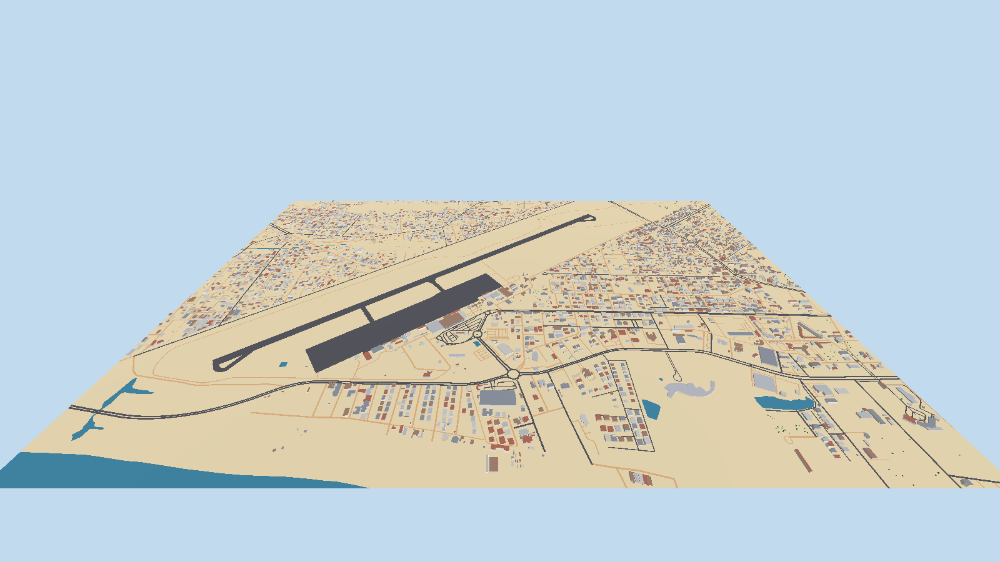

# ayigba

Générateur automatique de cartes 3D fidèles à de vrais lieux, pour les moteurs de jeu.
Priorité au Bénin : Cotonou d'abord, puis Ouidah, Porto-Novo et Parakou.

> « Ayigba » : la terre, le sol.



*Cadjèhoun et l'aéroport de Cotonou, générés en une commande et ouverts dans Godot 4.7. Données : © les contributeurs d'OpenStreetMap (ODbL).*

## Principe

La cohérence passe avant la fidélité à 100 %. Une carte sans trou, sans mur invisible et sans zone mal formée vaut mieux qu'une copie exacte mais cassée. Là où les données manquent, l'outil génère lui-même et marque ce qui est généré.

L'outil est indépendant de tout jeu : il ne contient ni missions, ni météo, ni scénario. Il produit une carte et ses données, c'est tout.

## État actuel (version 0.2, 17/11/2026)

Ce qui marche, vérifié sur deux lieux : Cadjèhoun à Cotonou (7,3 km², 4 302 bâtiments) et Ouidah (8,9 km², 7 985 bâtiments).

- **Du nom du lieu à la carte** : `ayigba creer "Ouidah, Bénin"` puis `ayigba generer`. Ouidah a été générée sans changer une ligne de code.
- **Collecte** OpenStreetMap avec cache : tout fonctionne hors ligne après le premier téléchargement.
- **Nettoyage** : routes recollées, carrefours manquants créés, doublons et chevauchements retirés, rues rétrécies entre les murs, passages couverts ouverts, mer déduite du trait de côte.
- **Secours** : routes isolées reliées ou retirées, îlots vides remplis de bâtiments cohérents avec leurs voisins, cours fermées comblées. Tout ce qui est généré est marqué `source = genere`.
- **Génération 3D** : sol en partition exacte (terre, chaussées, eau), bâtiments, auvents, décors légers (arbres, poteaux, lampadaires, étals).
- **Optimisation** : zones de 250 m chargeables à la demande, deux niveaux de détail, budget de triangles par zone (au plus 4 005 triangles de près dans une zone, pour un budget de 15 000).
- **Contrôles** : rapport de qualité avec 0 erreur et 0 avertissement sur les deux lieux ; 100 % de la surface libre accessible à pied.
- **Bots dans Godot 4.7.2** : des personnages ont parcouru toutes les routes avec la physique du moteur, soit 623 routes (118,6 km) à Cadjèhoun et 602 routes (129,4 km) à Ouidah, sans aucun blocage ni chute.
- **Export** : glTF (carte entière et zones), GeoJSON, routes en mètres pour le GPS, liste des décors, manifeste, fichier de crédits. Adaptateur Godot fourni.
- **Suivi** : instantanés, comparaison avant/après, retour en arrière (`ayigba instantane`, `comparer`, `restaurer`).
- **Reproductible** : même entrée et même graine donnent les mêmes fichiers. 120 tests automatiques.

Ce qui n'est pas fait ou pas vérifié :

- relief (le terrain est plat), toits en pente, façades, trottoirs, carrefours dessinés, ponts (rendus comme des remblais) ;
- sources autres qu'OpenStreetMap : presque toutes les hauteurs de bâtiments sont estimées ;
- bots en véhicule ou hors des routes, navmesh ;
- adaptateurs Unity et Unreal : écrits mais jamais testés, faute de moteur disponible ;
- interface graphique, IA de style, édition manuelle ;
- aucune comparaison avec le terrain réel ;
- Windows natif non testé pour l'outil lui-même : il a tourné sous Linux (WSL), Godot sous Windows.

Le plan complet et l'avancement sont dans [docs/CHANTIER.md](docs/CHANTIER.md). Le fonctionnement interne est dans [docs/ARCHITECTURE.md](docs/ARCHITECTURE.md).

## Utilisation

```bash
python3 -m venv .venv
.venv/bin/pip install -e ".[dev]"

# Générer le quartier d'essai (télécharge les données la première fois)
.venv/bin/ayigba generer projects/cotonou-cadjehoun

# Ensuite, sans réseau
.venv/bin/ayigba generer projects/cotonou-cadjehoun --hors-ligne

# Options : --jusqua <étape>, --etape <étape>, --forcer
.venv/bin/ayigba etapes

# Un nouveau lieu à partir de son nom
.venv/bin/ayigba creer "Ouidah, Bénin" --rayon-km 1.5
.venv/bin/ayigba generer projects/ouidah-benin

# Garder un résultat, comparer, revenir en arrière
.venv/bin/ayigba instantane projects/ouidah-benin --nom avant-essai
.venv/bin/ayigba comparer projects/ouidah-benin
```

Résultat dans `projects/<projet>/out/neutre/` : `carte.glb` (carte entière), `zones/` et `zones.json` (zones chargeables), `routes.geojson`, `routes_local.json`, `batiments.geojson`, `points_interet.geojson`, `decors.geojson`, `manifeste.json`, `CREDITS.md`. Le rapport de qualité est dans `reports/qualite.md` et le journal des décisions dans `logs/decisions.jsonl`.

Un projet est un dossier avec un fichier `config.toml` : la zone (rectangle en degrés), la graine, le style. Voir [projects/cotonou-cadjehoun/config.toml](projects/cotonou-cadjehoun/config.toml).

Tests : `.venv/bin/python -m pytest`.

Vérification dans Godot (projet de test, sans aucun jeu) : voir [adapters/godot/LISEZMOI.md](adapters/godot/LISEZMOI.md).

```bash
godot --headless --path verif/godot --script res://verifier_carte.gd -- carte=/chemin/vers/carte.glb
godot --headless --path verif/godot --script res://bots_routes.gd -- export=/chemin/vers/out/neutre routes=0
```

## Sources et licences des données

Les données ne sont pas dans ce dépôt. Chaque carte générée est livrée avec un fichier `CREDITS.md` qui liste les sources et leurs mentions obligatoires. OpenStreetMap est sous licence ODbL : la mention « © les contributeurs d'OpenStreetMap » doit apparaître partout où la carte est montrée. Ce n'est pas un avis juridique.

## Droits sur le code

© 2026 Olympe Mahougnon HOUNKPEVI. Aucune licence d'utilisation n'est accordée pour l'instant : le code est visible, tous droits réservés, jusqu'au choix d'une licence.
